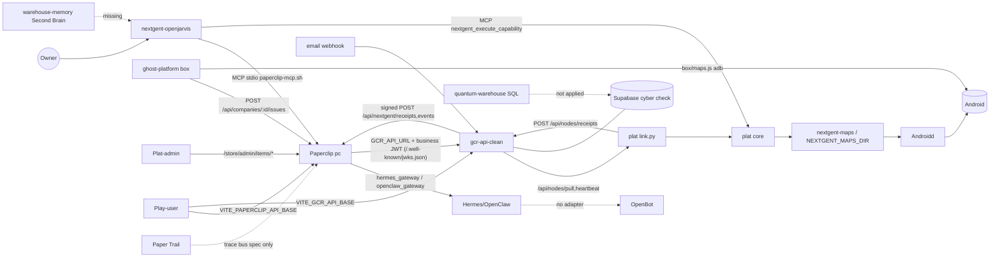

# NEXT GENT wiring map (read-only, 2026-10-15)
Branch key: **INT** = `codex/nextgent-integration-20261005`. Unless noted, gcr = gcr-api-clean@INT, pc = paperclip-ng@INT, plat = nextgent-platform@INT.

| From → To | Where (repo@branch:path:line) | How it connects (env / endpoint / MCP tool) | Status |
|---|---|---|---|
| Jarvis → Paperclip | nextgent-store (store-pc) `jarvis/paperclip-mcp.sh`, `jarvis/mcp-servers.example.json`, `jarvis/config.fragment.toml` | MCP stdio `packages/mcp-server/dist/stdio.js`; env `PAPERCLIP_API_URL`, `PAPERCLIP_API_KEY`, `PAPERCLIP_COMPANY_ID`, `PAPERCLIP_SOURCE_DIR`; tools `paperclipCreateIssue`, `paperclipListAgents`, `paperclipGetIssue`, `paperclipRequestConfirmation`, … | connected (config template; paths are `/absolute/path/to/…` placeholders) |
| Jarvis → phone core ("run a map itself") | nextgent-openjarvis@main `deploy/ghost/README.md:27,47` → plat `src/nextgent/mcp_server.py:21-93` | MCP stdio `nextgent-mcp`; tools `nextgent_execute_capability`, `nextgent_action_status`, `nextgent_capabilities`; env `NEXTGENT_CORE_URL`/`NEXTGENT_CORE_TOKEN` | connected (manual: `ghost install` does not copy `templates/nextgent-mcp`) |
| ghost-platform box → Paperclip | ghost-platform@main `wrappers/paperclip.js:13-16`; `config/example.config.json` | `paperclip_url`, `paperclip_token`, `paperclip_company_id`; `POST /api/companies/:id/issues` | connected (2nd, parallel path to Jarvis→PC) |
| ghost-platform box → phone maps | ghost-platform@main `box/maps.js:5-36` | `GHOST_MAPS` or `app_maps_dir`; allowlist `run_app_map`; direct adb, **no signature check / no core policy** | connected, bypasses plat core |
| Paperclip → workers | store-pc `activation.js:69,73` | adapterType `hermes_gateway`, `openclaw_gateway` | connected (Hermes); OpenClaw no image; OpenBot **missing** |
| Paperclip → gcr | pc `server/src/services/nextgent-business-link.ts:152`, `nextgent-gcr-client.ts:191,227` | env `GCR_API_URL`; `POST /api/nextgent/link`, `GET /api/nextgent/business-kinds`; business JWT verified at gcr `lib/paperclipAuth.js:67,74` (`PAPERCLIP_ISSUER`, `PAPERCLIP_JWKS_URL` → pc `routes/nextgent.ts:333` `/.well-known/jwks.json`) | connected |
| gcr → box link | gcr `server.js:376` (`/api/nodes`), `routes/nodes.js:413,430,529`; plat `src/nextgent/link.py:166-171` | `NEXTGENT_LINK_URL`, `NEXTGENT_NODE_TOKEN`; `POST /heartbeat`, `GET /pull`, `POST /requests/:rid/response` | connected |
| Paperclip/MCP → gcr ghost intent | gcr `server.js:360`, `routes/mcp-ghost.js:127-174` | `/api/mcp/ghost`; tools `nextgent_ghost_submit_intent`, `_request_status`, `_action_status`, `_action_receipt`, `_capabilities` | connected |
| link → core → maps → androidd | plat `src/nextgent/config.py:41-57`, `runtime.py` | `NEXTGENT_MAPS_DIR`, `NEXTGENT_POLICY_FILE`, `NEXTGENT_ANDROID_URL/TOKEN`, `NEXTGENT_OWNER_PHONE` | connected (no physical phone proven) |
| nextgent-maps → core | nextgent-maps@main `maps/*`, `scripts/validate_maps.py` → `NEXTGENT_MAPS_DIR` | file dir only | partial (no signature verify in `plat src/nextgent/maps/`) |
| Box receipts → gcr → Paperclip (Paper Trail) | plat `link.py:130` → gcr `routes/nodes.js:480` → `lib/ghostReceipts.js:95` → `lib/serviceSigning.js:147` → pc `routes/nextgent.ts:338` | `POST /api/nodes/receipts` → signed `POST /api/nextgent/receipts`; env `PAPERCLIP_API_URL`, `NEXTGENT_SERVICE_SECRET` | connected |
| gcr business events → Paperclip | gcr `lib/eventOutbox.js:53,56` (drained from `routes/automations.js:654`); table `business_event_outbox` (`sql/nextgent_event_outbox.sql:28`) → pc `routes/nextgent-events.ts:35` | signed `POST /api/nextgent/events` | connected (drain is manual/cron) |
| Paper Trail unified record | Boxes `spec/04-trace-bus.md`; plat `ledger.py` (`NEXTGENT_LEDGER_URL`); ang-cloud- receipts ledger | — | **missing** (no per-request prompt/tool-event trace) |
| Email ingest → payment match | gcr `server.js:534` → `routes/email-webhook.js:98` → `lib/payments.js:28` `recordPayment`; `server.js:547` `/api/email-parser` | `POST /api/webhooks/email` | connected internally; **no outbox event to Paperclip** |
| Stripe → gcr | gcr `server.js:501` `routes/stripe.js:304,738`; table `stripe_webhook_events` (`sql/nextgent_stripe_events.sql:16`) | `/api/stripe/*` | connected |
| gcr business data (tables) | gcr@main+INT `schema.sql:7` `entity` (=businesses), `:141` `entity_tags`, `:551` `entity_availability`; `sql/booking_ingestion_tables.sql:101` `business_availability`; `sql/capability_tables.sql` (`entity_operations`,`units`,`trips`,`packages`,`spaces`…); `sql/nextgent_apps.sql:50` `app_records`; `routes/analytics.js:61` `page_views`; `bookings`/`booking_holds` (routes only) | Supabase via `db.js` | exists. **No** `offerings(parent_id,tags,attributes)`, `reservations`, `visitors`, `clicks`, `receipts`, `module_installs`, `destinations` table in gcr (only `action_receipts` on branch `claude/user-dashboard-credit-accounts-qjbqsl` `sql/kernel/004_execution_proof.sql:198`) |
| gcr public query/action MCP | gcr `server.js:336,354` → `routes/mcp-public.js`, `lib/conciergeTools.js:66,123,151` | `/api/mcp/public`, `/api/mcp/business/:slug`; tools `search_businesses`, `get_business_details`, `check_availability`, `find_available`, `find_item_prices`, `compare_businesses`, `whats_on`, `list_categories`; owner MCP `/api/mcp` (`send_message`) | connected |
| quantum-warehouse → gcr DB | nextgent-quantum-warehouse@main `db/001_canonical.sql:6,35,84,166` (`businesses`,`offerings`,`reservations`,`receipts`…) ; nextgent-warehouse-operational@main `schema/canonical.ts` | — | **missing** (spec SQL, not in gcr `sql/`) |
| Second Brain → Jarvis/agents | nextgent-warehouse-memory@main `src/layers.ts`; nextgent-jarvis@main `src/types.ts` (SecondBrainRetrieval); ghost-platform `wrappers/vault.js` (`vault_dir`, `append_vault`) | — | **missing** (types only; only ghost-platform vault append exists) |
| Plat-admin → Paperclip store/releases | Plat-admin@main `src/api/paperclip.js:65-73` | `/store/admin/items`, `/versions`, `/publish`, `/retire`, `/store/admin/menu`; `VITE_API_BASE_URL` | connected (store) |
| Plat-admin → map/release signing | Plat-admin `src/api/paperclip.js` ↔ nextgent-ghost-image (ed25519 release sign) | — | **missing** (signing is ghost-image CLI only; no Plat-admin map signing) |
| Play-user → Paperclip / gcr | Play-user@main `src/lib/paperclip.js:8`, `src/lib/config.js:12` | `VITE_PAPERCLIP_API_BASE`, `VITE_GCR_API_BASE` | connected |
| App modules → gcr | App-build-@`claude/modular-app-ecosystem-7xteeg` `packages/engine`; gcr `server.js:464-465` (`/api/apps`, `/api/modules` UNMOUNTED); nextgent-apps@main docs only | `/api/store` (`server.js:307,404`) | partial; module_installs **missing** |

## Top 5 missing links
1. **Box map signing**: Plat-admin `src/api/paperclip.js` (release at :68) ↔ nextgent-platform@INT `src/nextgent/maps/` + `config.py:42` (`NEXTGENT_MAPS_DIR`). ghost-platform `box/maps.js:8` also runs unsigned maps without core policy.
2. **Canonical offerings/reservations/receipts tables**: nextgent-quantum-warehouse `db/001_canonical.sql` → gcr-api-clean@INT `sql/` (+ `lib/conciergeTools.js` `check_availability` / `find_available` to read them). Visitors, clicks, module_installs and destinations exist nowhere.
3. **Second Brain retrieval**: nextgent-warehouse-memory `src/layers.ts` ↔ nextgent-jarvis `src/types.ts` (and runtime `nextgent-openjarvis/deploy/ghost`). Only storage that exists: ghost-platform `wrappers/vault.js`.
4. **Paper Trail per-request trace**: nextgent-platform `src/nextgent/ledger.py` (`NEXTGENT_LEDGER_URL`) + gcr `lib/ghostReceipts.js` ↔ Paperclip `server/src/routes/nextgent-events.ts` (single envelope, per Boxes `spec/04-trace-bus.md`).
5. **Payment match → Paperclip**: gcr `routes/email-webhook.js:79,196` / `lib/payments.js:28` never enqueues into `lib/eventOutbox.js` (→ `/api/nextgent/events`). OpenBot also has no adapter next to store-pc `activation.js:69-73`.

## Dashboards (read-only, 2026-10-15)
Sources: `/workspace/repo-read/actual/<repo>.md` audits (status), `nextgent-assembly/comparisons/admin-dashboard-main-vs-plat-admin.md` and `cybercheck-login-audit.md`, plus `rg` over default-branch checkouts (`/workspace/repo-read/_default/*`; ghost-platform@`08421b4`, nextgent-shell@`8ca8ea3` cloned to /tmp). Dashboard-like repos from `gh repo list CultureReset --limit 400` (name/description matching dashboard|admin|console|panel): the 14 requested plus `nextgent-shell`, `Dashboard-`, `admin-login-`, `gcr-admin-` (the last three are **empty repos**). Supabase projects: `mkepugvdlktfsossumox` = the gcr-api-clean DB; `mhafixflyffflwjhcgfn` and `xbptmkpbiqzvxptjkfoi` are older, separate projects.

| dashboard | screens | talks to | status | overlaps with |
|---|---|---|---|---|
| Plat-admin | React admin shell; `src/modules/`: home, directory, booking, menu, content, engagement, ai, appstore, tripswipe, platform, **nextgent** (store items/versions/publish/retire/menu) | **Paperclip**: `VITE_API_BASE_URL` (`src/config/env.js:72`, default `''` at :64) → Vercel proxy `api/[...path].js:1` `PAPERCLIP_SERVER_URL`; `src/api/paperclip.js:65-73` `/store/admin/*` | runnable (stub-tested; prod data wiring blocked per HANDOFF) | Admin-dashboard-main (190/191 files shared), nextgent-shell (intended replacement) |
| Admin-dashboard-main | Same shell as Plat-admin plus automations, store, GhostBoxes (16 Admin-only files); no `nextgent` module | **gcr-api-clean**: `VITE_API_BASE_URL` (`src/config/env.js:69`, default `https://gcr-api-clean.vercel.app` at :61; `src/api/client.js:186`); dev proxy `VITE_DEV_API_PROXY` `vite.config.js:5` | runnable | Plat-admin (near-copy), gcr-admin / cybercheck-login (same admin role, older HTML) |
| Play-user | Business-owner app: Login, SignUp, Claim, AcceptInvite, BusinessPicker, Dashboard, AppStore; sections: hours, menu, offerings, events, specials, happy hour, price list, photos, reviews, FAQs, policies, progress | **Paperclip** `VITE_PAPERCLIP_API_BASE` (`src/lib/paperclip.js:8`, proxy `api/[...path].js:1` `PAPERCLIP_SERVER_URL`) + **gcr-api-clean** `VITE_GCR_API_BASE` (`src/lib/config.js:12`); script-only Supabase direct `scripts/reconcile-tables.mjs:16,49` (service key) | runnable | Dashboards-users- (fork-parent), admin-dashboard-, nextgent-shell |
| Dashboards-users- | Same pages as Play-user plus Store, Automations, Ghost | **gcr-api-clean** `VITE_GCR_API_BASE` (`src/lib/config.js:12`, default `:21`); script-only Supabase `scripts/make-setup-links.mjs:10,22` | runnable | Play-user (superset of its pages, no Paperclip), admin-dashboard- |
| admin-dashboard- | Login, Claim, BusinessPicker, Dashboard (user-side, despite the name) | **gcr-api-clean** `VITE_GCR_API_BASE` (`src/lib/config.js:15`) + **Supabase direct** `VITE_SUPABASE_URL`/`VITE_SUPABASE_ANON_KEY` (`src/lib/config.js:20,30`; `src/lib/AuthContext.jsx:44` `supabase.from`) | runnable | Play-user / Dashboards-users- (earlier 4-page version) |
| Universal-dashboard- | none (README + workflow, 0 code LOC) | nothing | scaffold | nextgent-shell (same "one dashboard" idea) |
| Boxes | Ghost box TV shell (`shell/`): home screens, apps, agents, files, calendar, ask bar; `apps/menu` | local daemon `NEXT_PUBLIC_DAEMON_URL` (`apps/menu/lib/api.ts:15`, ghost-tv `127.0.0.1:7770`); voice service **Supabase direct** `SUPABASE_URL`/`SUPABASE_SERVICE_KEY` (`services/voice/config/database.js:8-15`); gcr-api-clean only referenced in comment (`daemon/src/platform/capabilities.ts:20`) | runnable | ghost-platform console (both operate the box), cybercheck-orchestrator (capability/install model) |
| ghost-platform operator console | `console/`: 4 tabs Work, Install (allowlist), Addresses, Vault (append-only) | **Paperclip** via `console/src/lib/ghost/bridge.ts:4,34` (kinds probe/paperclip/vault/sms/inbox/call/notebook/map; addresses held in browser); box side `wrappers/paperclip.js:13` `paperclip_url` | partial (front end only; does not start services; no audit file) | Boxes (box UI), Plat-admin (Paperclip operator) |
| cybercheck-dashboard | `cybercheck-dashboard-platform/`: login, overview, business-details, workflows, oauth, settings tabs; also bundles `cybercheck-backend-api/` + `circle-boats-website/` | **Supabase direct** (old project `mhafixflyffflwjhcgfn`, `cybercheck-dashboard-platform/js/supabase-client.js:4-5`); bundled own backend `cybercheck-backend-api/db.js:4-5` | partial | cybercheck-login, gcr-admin, cyber-admin |
| cybercheck-saas | Static: login, signup, forgot-password, onboarding (profile/hours/fleet/Stripe); `site-template/`, `embed.js` widget | `https://cybercheck-api-database.vercel.app` hard-coded (`embed.js:3`) — none of the four target backends | runnable (static HTML) | cybercheck-login (auth pages), gcr-admin (onboarding) |
| cybercheck-login | ~80 static pages: admin-dashboard, admin, pricing, app-store, installed-apps, automations/builder/templates, booking, menu editors, card builder, connection manager, charter/restaurant dashboards, gcr-entity-manager, claim-business, customer-dashboard | **Supabase direct** gcr DB `mkepugvdlktfsossumox` (`js/supabase-client.js:5-6`) + **gcr-api-clean** `window.CC_API_BASE` (`js/supabase-client.js:88`, `manage.html:48`); `api/whatsapp/disconnect.js:1-2` service key | runnable (static HTML) | gcr-admin (same page set, ~1:1), Admin-dashboard-main, Play-user |
| gcr-admin | Same HTML page set as cybercheck-login plus analytics, billing, developer portal, sandbox editor/deploy, onboarding-links, reviews, status, workflow-logs | **Supabase direct** old project `xbptmkpbiqzvxptjkfoi` (`js/supabase-client.js:4-12`, `onboarding-links.html:183`); `https://gcr-api.vercel.app` (`card.html:150`, old gcr-api, not -clean) | runnable (static HTML) | cybercheck-login (parent copy), Admin-dashboard-main |
| cyber-admin | Grab-bag: `dashboard/`, `dashboard-booking`, `-circleboat`, `-taxi`, beachside-dashboard, trip-concierge/taxi HTML dashboards, gcr-directory tools, seed pages, scrapers, rag-api | **Supabase direct** old project `mhafixflyffflwjhcgfn` (`dashboard-booking/js/supabase-client.js:1-3`, `seed-pages/seed-coffee-sweets.html:98`); `cybercheck-api-database.vercel.app` (`templates/scroll-profile-BLANK.html:15`) | partial | cybercheck-dashboard, gcr-admin, per-vertical demos |
| cybercheck-orchestrator | No UI. HTTP API `src/http/server.js`: `/api/packages`, `/api/capabilities`, `/api/b/:slug/installs`, `/invoke`, `/approvals`; modules availability, business_profile | own `src/db.js`; no Paperclip/gcr env found | partial (server boots `listening on :0`) | Boxes daemon, Plat-admin appstore / gcr module installs |
| nextgent-shell | One route `src/routes/index.tsx`, Admin + Business doors; businesses and modules as local data (`src/lib/gent/store.ts`) | nothing (README: does not read gcr-api-clean, store, or box) | scaffold/prototype (local-only) | Plat-admin + Play-user (meant to unify), Universal-dashboard- |
| Dashboard-, admin-login-, gcr-admin- | — | — | empty repos | — |

**Takeaways:** two live lineages. (1) React: Plat-admin/Admin-dashboard-main (admin) and Play-user/Dashboards-users-/admin-dashboard- (owner). Only Plat-admin and Play-user talk to Paperclip; the rest talk to gcr-api-clean. (2) Legacy static HTML: cybercheck-login → gcr-admin, cybercheck-dashboard, cyber-admin, cybercheck-saas. These mostly hit Supabase directly, often an older project and not the gcr DB. Box UIs (Boxes, ghost-platform console) are separate from both lineages.
